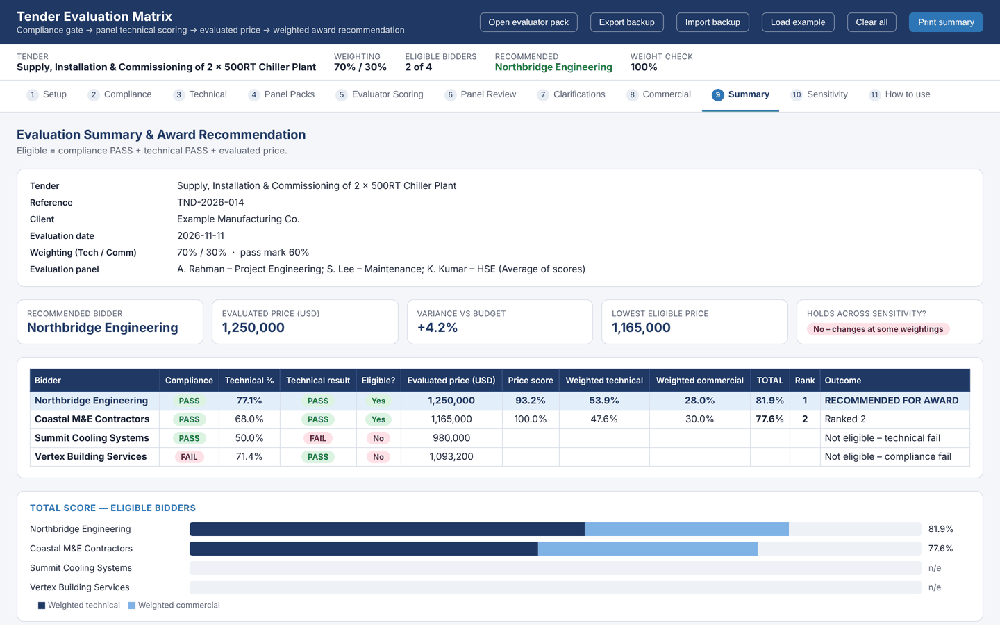
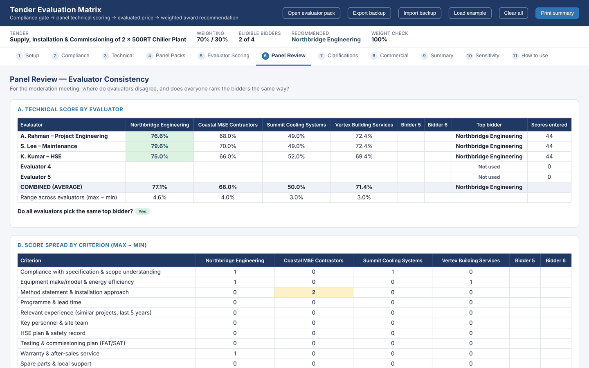
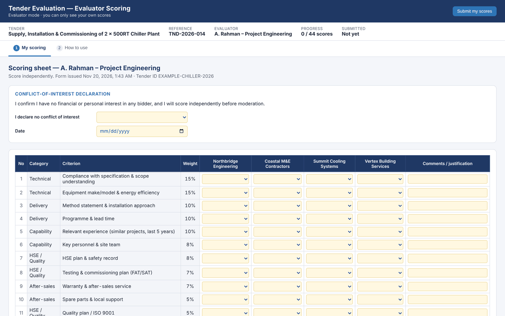
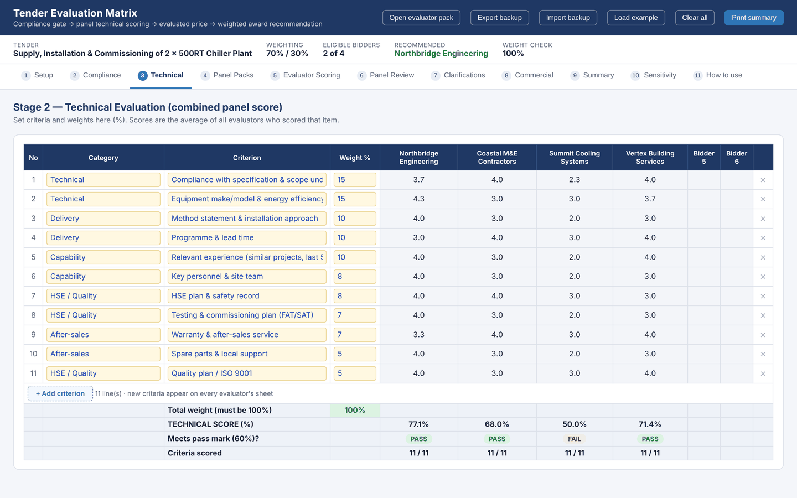
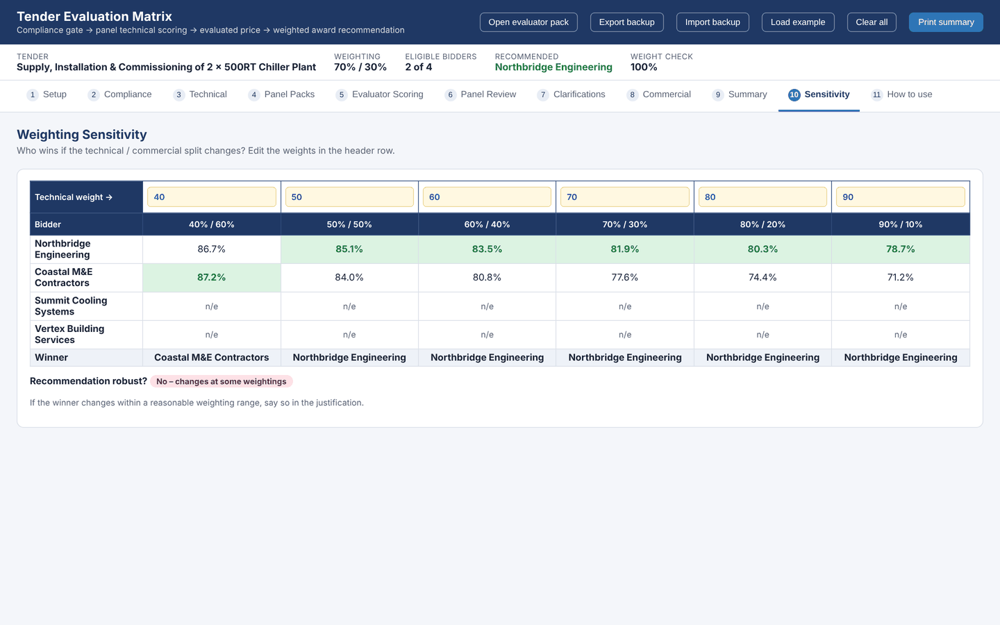

# Tender Evaluation Matrix

**Pick the right bidder — and be able to defend it.**

A free, open-source tool for evaluating tenders, bids and vendor proposals the way formal procurement does: a compliance gate, blind panel scoring, a like-for-like evaluated price, a weighted ranking, a sensitivity check and a printable recommendation for management.

It is **one HTML file**. Open it in any browser — no install, no login, no server, works offline. An Excel / Google Sheets version is included too.



---

## Try it

- **Online:** `https://<your-github-username>.github.io/tender-evaluation-matrix/` *(after you enable GitHub Pages — see below)*
- **Offline:** download [`index.html`](index.html) and double-click it.

The tool opens with a worked example (a fictional chiller plant tender with four bidders) so you can see how everything fits together. Use **Clear all** to start your own.

## Features

| Stage | What it does |
|---|---|
| **1. Compliance** | Pass/fail mandatory requirements (bid bond, signed Form of Tender, licences…). Any “No” makes a bidder ineligible. Unlimited lines. |
| **2. Technical** | Unlimited weighted criteria, scored 0–5 with an editable scoring scale. A technical **pass mark** stops weak bids winning on price. |
| **3. Panel scoring** | Up to 5 evaluators. Scores are combined by **average or median**. |
| **4. Blind scoring forms** | Generate a personal scoring form (one HTML file) for each evaluator. They score independently — they never see other evaluators' scores or bid prices — and send back a small score file you import. |
| **5. Panel review** | Each evaluator's scores side by side, flags criteria where evaluators differ by 2+ points, checks whether everyone picked the same winner, and records conflict-of-interest declarations. |
| **6. Clarifications** | Log every clarification. A cost impact (e.g. excluded scope) is added automatically to that bidder's evaluated price. |
| **7. Commercial** | Bid price + arithmetic corrections + clarification add-backs + other adjustments = **evaluated price**, with variance against your budget estimate. |
| **8. Summary** | Eligibility, price score, weighted total, rank and outcome for each bidder; recommendation text; approval sign-off block; **Print summary** to PDF. |
| **9. Sensitivity** | Shows who wins at different technical/commercial weightings, so you know whether your recommendation is robust. |

### Scoring method

```
Eligible    = Compliance PASS  and  Technical score ≥ pass mark  and  evaluated price entered
Price score = lowest evaluated price among eligible bidders ÷ this bidder's evaluated price
Total       = Technical % × technical weight  +  Price score × commercial weight
```

## Screenshots

| Panel review | Evaluator's blind scoring form |
|---|---|
|  |  |

| Technical criteria | Sensitivity |
|---|---|
|  |  |

## How blind panel scoring works

1. The tender lead sets up bidders (**Setup**) and criteria (**Technical**).
2. On **Panel Packs**, click **Create scoring form** for each evaluator and send them that one `.html` file.
3. Each evaluator opens it, completes the conflict-of-interest declaration, scores, and clicks **Submit my scores**. A small `.json` score file downloads — they send it back.
4. The lead clicks **Import score files**. Files from a different tender are rejected; if criteria changed after forms were issued, you are warned.
5. Hold the moderation meeting using **Panel Review**.

Scoring forms contain only the bidder names, criteria and that evaluator's name — no prices and no other evaluator's scores.

## Your data and privacy

- Nothing is uploaded anywhere. All data stays in **your browser on your computer** (local storage).
- The `index.html` file itself never contains your data, so it is safe to share.
- Use **Export backup** to save a `.json` copy, move to another computer, or archive a tender. **Import backup** reopens it. Clearing your browser data deletes the saved copy, so export regularly.
- Don't send your backup file to evaluators — it contains everyone's scores and prices.

## Excel / Google Sheets version

[`excel/Tender_Evaluation_Matrix.xlsx`](excel/Tender_Evaluation_Matrix.xlsx) has the same method in spreadsheet form: Setup, Compliance, five evaluator tabs, combined Technical, Panel Review, Clarifications, Commercial, Summary (with chart and sign-off block) and Sensitivity. No macros. Google Sheets: *File → Import*.

To rebuild it from source: `pip install openpyxl` then `python scripts/build_excel.py`.

## Publish your own copy with GitHub Pages

1. Fork or upload this repository to your GitHub account.
2. **Settings → Pages → Build and deployment → Source: Deploy from a branch**, branch `main`, folder `/ (root)` → **Save**.
3. After a minute, the tool is live at `https://<your-username>.github.io/tender-evaluation-matrix/`.

## Limits

- Up to 6 bidders and 5 evaluators per tender (criteria and compliance lines are unlimited).
- Tested in current Chrome and Edge. Other modern browsers should work.
- It's a decision-support tool: check results and follow your organisation's procurement policy before making an award.

## Contributing

Issues and pull requests are welcome — bug reports, new features, translations, or criteria libraries for different trades. Please keep it a single self-contained HTML file with no external dependencies.

## License

[MIT](LICENSE) © 2026 Asyraf Abdul — free to use, copy, modify and share, including commercially, as long as the copyright notice and licence are kept. Provided "as is", without warranty.
